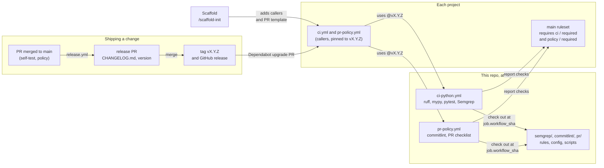

# Standards

Shared, enforceable CI for every project: lint, types, tests, money-handling rules, commit
conventions and the PR checklist. Projects call these workflows pinned to a release tag, and make
them required checks, so nothing merges unless the shared standard passes.

Per-project starting files (agent instructions, hooks, the CI caller) live in
[Scaffold](https://github.com/edward-sf/Scaffold), whose `/scaffold-init` wires a new project to
this repo. Why it's split this way: [ADR 0001](docs/adr/0001-enforce-standards-through-pinned-reusable-workflows.md).

## Architecture



A project's two caller workflows run the reusable workflows here at an exact tag. Those
workflows load the rules, config and scripts from this repo at the same commit, so a project
can't run rules newer or older than the tag it pinned. Each workflow ends in one `required` job,
which is the check the project's ruleset requires. Changes ship as a new tag through the release
PR, and Dependabot offers each tag to every project as an upgrade PR, which runs the new standard
against that project before it merges.

## What's here

| Path | What it enforces |
| --- | --- |
| [`.github/workflows/ci-python.yml`](.github/workflows/ci-python.yml) | Python (uv) CI: `ruff check`, `ruff format --check`, `mypy`, `pytest`, Semgrep. |
| [`.github/workflows/pr-policy.yml`](.github/workflows/pr-policy.yml) | Any stack: Conventional Commits on every commit and the PR title, and the PR checklist. |
| [`semgrep/money-rules.yml`](semgrep/money-rules.yml) | No floats for money, no `Decimal` from floats, no card data in logs. |
| [`semgrep/idempotency/`](semgrep/idempotency/) | Idempotency keys on money-moving calls: one file per payment provider, plus a rule for the project's own payment functions. |
| [`semgrep/semgrepignore`](semgrep/semgrepignore), [`semgrep/scan.sh`](semgrep/scan.sh) | What Semgrep skips, and how CI runs it. Projects can't override the ignore list with their own `.semgrepignore`. |
| [`semgrep/requirements.txt`](semgrep/requirements.txt), [`semgrep/semgrep.sh`](semgrep/semgrep.sh) | The one pinned Semgrep version, and the wrapper every workflow and local command runs it through. |
| [`commitlint/`](commitlint/) | Conventional Commits config and its pinned, locked commitlint. |
| [`.github/pull_request_template.md`](.github/pull_request_template.md) | The PR template. Its checklist is what `pr-policy` checks; Scaffold copies it into projects. |
| [`docs/adr/`](docs/adr/) | Decisions behind the standards. |
| [`CHANGELOG.md`](CHANGELOG.md) | What each release changed. Written by `release.yml`; see [Releasing](#releasing). |

The rest (`self-test.yml`, `policy.yml`, `release.yml`, `tests/fixtures/`) tests and releases
this repo itself.

## Using it in a project

Add two caller workflows, pinned to an exact tag. Scaffold's `/scaffold-init` does this for you.

```yaml
# .github/workflows/ci.yml
name: CI
on:
  pull_request:
  push:
    branches: [main]
jobs:
  ci:
    uses: edward-sf/standards/.github/workflows/ci-python.yml@v1.0.0
```

```yaml
# .github/workflows/pr-policy.yml
name: PR policy
on:
  pull_request:
    types: [opened, edited, synchronize, reopened]
jobs:
  policy:
    uses: edward-sf/standards/.github/workflows/pr-policy.yml@v1.0.0
```

Then, in the project:

1. **Require the checks.** In the `main` ruleset, require `ci / required` and `policy / required`.
   Each is a gate job that fails unless every check in its workflow passed, so the names stay
   stable as checks are added.
2. **Add Dependabot** for `github-actions`, so new releases here arrive as upgrade PRs.
3. **Meet the Python workflow's assumptions.** You need `pyproject.toml` and a current `uv.lock`
   (`uv sync --locked` must pass), with `ruff`, `mypy` and `pytest` in the dev dependencies. Their
   rules live in `pyproject.toml`. pytest fails when there are no tests.

### `ci-python.yml` inputs

All are optional. Each one lives in the project's `ci.yml`, so changing it is a reviewed PR there.

| Input | Use |
| --- | --- |
| `working-directory` | The project is in a subdirectory, e.g. `api`. |
| `python-version` | Override `.python-version` / `requires-python`. |
| `semgrep-config` | Project Semgrep rules, one path per line, e.g. `.semgrep`. They run alongside the shared rules, which can't be turned off. |
| `semgrep-exclude` | Paths Semgrep should skip, one per line, gitignore syntax, e.g. `/src/generated/`. A project's own `.semgrepignore` is ignored, so this is the only way to exclude code. |

Semgrep doesn't scan tests (`tests/`, `test_*.py`, `conftest.py`). Tests use fake card numbers and
call payment functions without keys on purpose.

## Idempotency rules

Calls that move money must carry an idempotency key, so a retry after a timeout can't charge or
pay twice. Three layers enforce this:

1. **Provider SDKs:** one rule file per provider in `semgrep/idempotency/`, e.g.
   [`stripe.yml`](semgrep/idempotency/stripe.yml).
2. **The project's own payment functions:**
   [`payment-functions.yml`](semgrep/idempotency/payment-functions.yml). Each project wraps its
   provider once, and layer 1 checks that wrapper. Any call to a function named like `charge`,
   `refund`, `payout`, `create_payment`, `capture_payment`, `pay_invoice` or `initiate_transfer`
   must also pass `idempotency_key=`. So the key comes from the business operation (the order,
   the refund request), not from a fresh UUID minted inside the wrapper on every attempt. Lookups
   such as `refund_status` or `payment_id` are excluded.
3. **Project-local rules:** for anything specific to one project, such as an internal ledger API,
   add rules in the project and pass them with `semgrep-config`. See
   [`tests/fixtures/python-app/.semgrep/`](tests/fixtures/python-app/.semgrep/) for an example
   with tests.

If a flagged function really doesn't move money, rename it or add
`# nosemgrep: payment-call-idempotency-key-required` with a reason. Reviewers should treat every
`nosemgrep` as an exception to justify.

### Adding a payment provider

1. Copy `semgrep/idempotency/stripe.yml` to `<provider>.yml`. Match the provider SDK's
   money-moving calls, and exclude calls that pass its idempotency parameter.
2. Add `<provider>.py` next to it with `# ruleid:` and `# ok:` cases, including the SDK's
   async and client-object styles.
3. Release as a minor version. The workflow loads the whole `semgrep/` folder, so nothing
   else changes.

To test project rules (`semgrep --test` skips hidden folders like `.semgrep/`, so pass paths), use
the Semgrep version in [`semgrep/requirements.txt`](semgrep/requirements.txt), which is what CI
runs them with:

```sh
cd .semgrep && uvx --from semgrep==<version> semgrep --test --config ledger.yml ledger.py
```

## Changing a standard

1. **Open a PR here.** Add an ADR in `docs/adr/` (copy `0000-template.md`) for anything that
   changes what projects must do: a new rule, a stricter check, a new requirement. Fixes and tool
   bumps don't need one.
2. **Test it.** Add `# ruleid:` and `# ok:` cases next to any rule you change. `self-test.yml`
   runs the rule tests and the checklist tests, lints the workflows, and runs `ci-python.yml`
   against `tests/fixtures/python-app`.
3. **Merge, then merge the release PR.** See [Releasing](#releasing). Never move or reuse a tag;
   projects pin them.
4. **Dependabot opens the upgrade PR in each project.** It shows whether the project passes the
   new standard before anyone merges it.

### Releasing

[`release.yml`](.github/workflows/release.yml) runs
[release-please](https://github.com/googleapis/release-please) on every push to `main`. It keeps
one release PR open, `chore(main): release X.Y.Z`, that bumps the version and adds every change
merged since the last release to [`CHANGELOG.md`](CHANGELOG.md). Merging it tags `vX.Y.Z` and
publishes the GitHub release with the same notes. Nothing is released until you merge that PR,
so let changes pile up and release when it suits.

The version and the changelog come from the squash-merged PR titles, so the type you give a PR
decides the release:

| PR title | Release | Changelog section |
| --- | --- | --- |
| `feat!: …`, or a `BREAKING CHANGE:` footer | Major | Breaking changes |
| `feat: …` | Minor | Features |
| `fix: …`, `perf: …`, `revert: …` | Patch | Bug fixes, Performance improvements, Reverts |
| `docs:`, `ci:`, `test:`, `build:`, `chore:`, … | None on its own | Not listed |

Pick the type from [Versioning](#versioning), not from what the change feels like: a stricter
check that existing code may fail is `feat`, even when it closes a gap in a rule. Dependabot's
tool bumps are `ci:` and `build:`, so they ship with the next release rather than starting one.
To override the computed version, merge a commit to `main` whose message has a
`Release-As: 2.0.0` footer. To fix a wrong changelog entry, edit the release PR before merging it.

The release PR is a normal PR: its required checks must pass. Its checklist is answered in
`pull-request-footer` in [`.github/release-please-config.json`](.github/release-please-config.json),
so when the PR template's checklist changes, change that footer to match or release PRs fail
`pr-policy`.

**One-time setup.** PRs opened with `GITHUB_TOKEN` don't trigger workflows, so release-please uses
a GitHub App instead, or its PRs could never pass their required checks:

1. Create a GitHub App owned by your account, with no webhook and these repository permissions:
   Contents, Pull requests and Issues, all read and write. Install it on this repo only.
2. In this repo's **Settings > Secrets and variables > Actions**, add the App's client ID as the
   variable `RELEASE_APP_CLIENT_ID` and a private key as the secret `RELEASE_APP_PRIVATE_KEY`.
3. If the `main` ruleset restricts tag creation, let the App create `v*` tags.

### Versioning

| Release | When | Examples |
| --- | --- | --- |
| Major (`v2.0.0`) | Projects must change their setup to keep working. | Renaming a required check, removing or renaming an input, a new project requirement (e.g. a lockfile). |
| Minor (`v1.1.0`) | A new or stricter check that existing code may fail. The upgrade PR shows it. | New Semgrep rule or provider, new pytest flag. |
| Patch (`v1.0.1`) | No new failures expected. | Fewer false positives, tool bumps, docs. |

Dependabot opens PRs for majors too. Projects opt in by merging them, after making the setup
change the release notes describe.

### Tool versions

Dependabot keeps every tool version current: the actions, commitlint, the fixture's Python tools
and Semgrep. Semgrep's version lives only in [`semgrep/requirements.txt`](semgrep/requirements.txt);
CI and the local commands below all run it through [`semgrep/semgrep.sh`](semgrep/semgrep.sh), so
a Dependabot bump there reruns the rule tests at the new version before anyone merges it.

## Testing locally

```sh
bash semgrep/semgrep.sh --test --metrics=off semgrep/                 # Semgrep rule tests
python3 -m unittest discover -s pr                                    # checklist script tests
actionlint                                                            # workflow lint (uses .github/actionlint.yaml)
```

`semgrep --test` exits 0 even when a rule file fails to load. Read its summary, or do what CI
does: add `--json > results.json`, then run `python3 semgrep/check_tests.py results.json semgrep`.

On Windows, set `PYTHONUTF8=1` first. If rule files fail to load with a `PermissionError` on
Semgrep's settings file (parallel test workers collide on it), test one file at a time:
`bash semgrep/semgrep.sh --test --config semgrep/money-rules.yml semgrep/money-rules.py`.

## Security

This repo is public: it holds no secrets, and being public lets every project's `GITHUB_TOKEN`
load the rules without extra setup. The cost is that anyone can read the rules. They catch
mistakes; they aren't a defense against someone deliberately evading them, which is what code
review is for.

Workflows from fork PRs need maintainer approval before they run (**Settings > Actions >
General**). They run with a read-only token and no secrets.

## Change-management evidence

For SOC 2-style change management, the evidence is already in GitHub:

- **What changed and why:** PRs and ADRs here.
- **Who approved it:** PR reviews. `CODEOWNERS` plus the ruleset make review required.
- **What shipped when:** releases, tags and `CHANGELOG.md`.
- **When each project adopted it:** the merged Dependabot PR in that project.
- **That it was enforced:** required-check results on each project PR.
